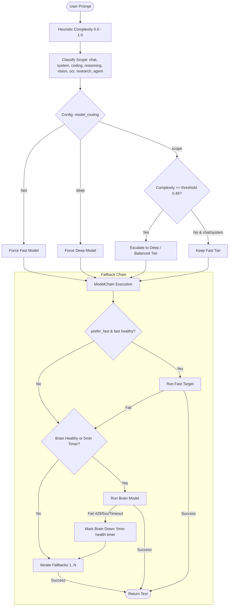

# S.A.G.E. Rust Port Specification: Models & Providers Layer

## 1. Provider Protocols & Endpoints

### 1.1 Google Gemini AI Studio (Native REST)
* **Base URL**: `https://generativelanguage.googleapis.com/v1beta` ([gemini.py:27](file:///C:/SAGE/sage/gemini.py#L27)).
* **Auth**: Header `x-goog-api-key: <key>` ([gemini.py:105](file:///C:/SAGE/sage/gemini.py#L105)). Resolved via config key `gemini_api_key` or env `GEMINI_API_KEY` / `GOOGLE_API_KEY` ([gemini.py:51-52](file:///C:/SAGE/sage/gemini.py#L51-L52)).
* **Endpoints**:
  * One-shot: `POST /models/{model}:generateContent` ([gemini.py:223](file:///C:/SAGE/sage/gemini.py#L223), [gemini.py:232](file:///C:/SAGE/sage/gemini.py#L232)).
  * SSE Stream: `POST /models/{model}:streamGenerateContent?alt=sse` ([gemini.py:244](file:///C:/SAGE/sage/gemini.py#L244)).
  * Embeddings: `POST /models/{model}:embedContent` ([gemini.py:273](file:///C:/SAGE/sage/gemini.py#L273)).
* **Request Format**: JSON payload `{"contents": [{"role": "user", "parts": [...]}], "generationConfig": {"temperature": f32, "maxOutputTokens": u32, ...}}` ([gemini.py:110-129](file:///C:/SAGE/sage/gemini.py#L110-L129)). Supports `inline_data` base64 PNG images ([gemini.py:113](file:///C:/SAGE/sage/gemini.py#L113)). Gemma prepends system prompt to user text; other models pass `systemInstruction` ([gemini.py:124-128](file:///C:/SAGE/sage/gemini.py#L124-L128)). Thinking models use `thinkingConfig`: `thinkingBudget: u32` for Gemini 2.0/2.5 or `thinkingLevel: "minimal"|"low"|"medium"|"high"` for Gemini 3+ ([gemini.py:59-73](file:///C:/SAGE/sage/gemini.py#L59-L73)).
* **Streaming Format**: SSE text stream yielding `data: {...}` lines parsed for `candidates[0].content.parts[]` (`text` and `thought`) ([gemini.py:203-215](file:///C:/SAGE/sage/gemini.py#L203-L215), [gemini.py:251-269](file:///C:/SAGE/sage/gemini.py#L251-L269)).
* **Tool Calling**: Prompt-driven JSON schema returning structured planning decisions ([cortex.py:68-133](file:///C:/SAGE/sage/cortex.py#L68-L133)).

### 1.2 OpenAI-Compatible Cloud Pool & Local Providers
* **Auth**: Header `Authorization: Bearer <key>` ([llm_catalog.py:218](file:///C:/SAGE/sage/llm_catalog.py#L218), [swarm.py:395](file:///C:/SAGE/sage/swarm.py#L395)). Ollama requires no key ([swarm.py:527](file:///C:/SAGE/sage/swarm.py#L527)). OpenRouter injects `HTTP-Referer` and `X-Title` ([swarm.py:493-494](file:///C:/SAGE/sage/swarm.py#L493-L494)).
* **Endpoints**:
  * Chat: `POST {base_url}/chat/completions` ([llm_catalog.py:374](file:///C:/SAGE/sage/llm_catalog.py#L374), [swarm.py:397](file:///C:/SAGE/sage/swarm.py#L397)).
  * Models List: `GET {base_url}/models` ([llm_catalog.py:240](file:///C:/SAGE/sage/llm_catalog.py#L240)).
* **Base URLs**:
  * Groq: `https://api.groq.com/openai/v1` ([swarm.py:470](file:///C:/SAGE/sage/swarm.py#L470)).
  * Cerebras: `https://api.cerebras.ai/v1` ([swarm.py:475](file:///C:/SAGE/sage/swarm.py#L475)).
  * Gemini (OpenAI bridge): `https://generativelanguage.googleapis.com/v1beta/openai` ([swarm.py:479](file:///C:/SAGE/sage/swarm.py#L479)).
  * OpenRouter: `https://openrouter.ai/api/v1` ([swarm.py:485](file:///C:/SAGE/sage/swarm.py#L485)).
  * Mistral: `https://api.mistral.ai/v1` ([swarm.py:495](file:///C:/SAGE/sage/swarm.py#L495)).
  * NVIDIA NIM: `https://integrate.api.nvidia.com/v1` ([swarm.py:500](file:///C:/SAGE/sage/swarm.py#L500)).
  * SambaNova: `https://api.sambanova.ai/v1` ([swarm.py:505](file:///C:/SAGE/sage/swarm.py#L505)).
  * APInex: `https://api.apinex.bond/v1` ([swarm.py:510](file:///C:/SAGE/sage/swarm.py#L510)) (guarded with strict allowlist in [swarm.py:514-522](file:///C:/SAGE/sage/swarm.py#L514-L522)).
  * Ollama: `http://localhost:11434/v1` ([swarm.py:526](file:///C:/SAGE/sage/swarm.py#L526)).
* **Format**: Standard OpenAI JSON `{"model": str, "messages": [{"role": "system"|"user", "content": str}], "temperature": f32, "max_tokens": u32}`. Optional `response_format: {"type": "json_object"}` with fallback retry without it on 400/422 ([llm_catalog.py:370-383](file:///C:/SAGE/sage/llm_catalog.py#L370-L383), [swarm.py:406-427](file:///C:/SAGE/sage/swarm.py#L406-L427)). Synchronous responses parse `choices[0].message.content` and reasoning fields ([llm_catalog.py:398-402](file:///C:/SAGE/sage/llm_catalog.py#L398-L402), [swarm.py:453-462](file:///C:/SAGE/sage/swarm.py#L453-L462)).

---

## 2. CLI Execution & Stream Parsing

### 2.1 Claude Code CLI
* **Binary Discovery**: Checks `~/.local/bin/claude.exe`, PATH `claude`, `claude.exe` ([claude_backend.py:40-50](file:///C:/SAGE/sage/claude_backend.py#L40-L50)).
* **Auth**: Uses active logged-in CLI subscription profile. Strips `ANTHROPIC_API_KEY` from process environment ([claude_backend.py:172](file:///C:/SAGE/sage/claude_backend.py#L172)).
* **Argv Construction**:
  * Shared base: `[executable, "-p", "--model", model, "--output-format", "stream-json", "--verbose", "--include-partial-messages", "--no-session-persistence", "--effort", effort]` ([claude_backend.py:281-283](file:///C:/SAGE/sage/claude_backend.py#L281-L283)).
  * Text mode: `+ ["--tools", "", "--system-prompt", system]` ([claude_backend.py:284-285](file:///C:/SAGE/sage/claude_backend.py#L284-L285)).
  * Agent mode: `+ ["--append-system-prompt", system, "--permission-mode", "bypassPermissions"|"acceptEdits", "--max-turns", str(max_turns), "--allowedTools", <tools...>, <mcp_prefixed_tools...>]` plus `["--add-dir", <path>]` for configured workspaces ([claude_backend.py:286-299](file:///C:/SAGE/sage/claude_backend.py#L286-L299)).
* **I/O & Parsing**: Prompt is written to `stdin` and closed ([claude_backend.py:178-180](file:///C:/SAGE/sage/claude_backend.py#L178-L180)). `stdout` produces line-delimited JSON events ([claude_backend.py:203-247](file:///C:/SAGE/sage/claude_backend.py#L203-L247)):
  * `stream_event`: parses `delta.text_delta` (text) and `delta.thinking_delta` (reasoning).
  * `assistant`: captures `content[].type == "tool_use"` with name and input args.
  * `user`: captures `content[].type == "tool_result"`.
  * `system`: subtype `init` discovers active MCP servers and installed skills; subtype `status` emits runtime state.
  * `rate_limit_event`: updates usage limits (`resetsAt`, window utilization threshold >= 90% blocks execution) ([claude_backend.py:88-109](file:///C:/SAGE/sage/claude_backend.py#L88-L109), [claude_backend.py:237-238](file:///C:/SAGE/sage/claude_backend.py#L237-L238)).
  * `result`: reads final text, `is_error`, and `total_cost_usd`.

### 2.2 Antigravity CLI (`agy`)
* **Binary Discovery**: Checks `%LOCALAPPDATA%\agy\bin\agy.exe`, PATH `agy`/`agy.exe`, or `%LOCALAPPDATA%\Programs\Antigravity\bin\antigravity.cmd` ([config.py:17-28](file:///C:/SAGE/sage/config.py#L17-L28)).
* **Subprocess Execution**:
  * Headless stateless JSON mode (`AntigravityClient`): `[executable, "--dangerously-skip-permissions", "--output-format", "json", "--model", model, "--print=" + prompt]` ([antigravity.py:187-193](file:///C:/SAGE/sage/antigravity.py#L187-L193)). Windows prompt length capped at 18,000 chars ([antigravity.py:184-185](file:///C:/SAGE/sage/antigravity.py#L184-L185)).
  * Streaming session mode (`AgyClient`): `[executable, "--dangerously-skip-permissions", ("--new-project" | "--continue"), "-p", prompt]` ([cli_client.py:42-51](file:///C:/SAGE/sage/cli_client.py#L42-L51)).
* **Output Parsing**:
  * Extracts JSON block from stdout to read `response`, `status`, `conversation_id`, and `usage.total_tokens` ([antigravity.py:215-250](file:///C:/SAGE/sage/antigravity.py#L215-L250)).
  * Evaluates stdout/stderr against `QUOTA_PATTERNS` regex ([antigravity.py:26-31](file:///C:/SAGE/sage/antigravity.py#L26-L31)). Parses string `resets in <d>d<h>h<m>m<s>s` to set block timestamp in state JSON ledger ([antigravity.py:124-135](file:///C:/SAGE/sage/antigravity.py#L124-L135)).

---

## 3. Complexity & Routing Fallback Architecture

* **Complexity Heuristic**: In `[0.0, 1.0]`. Base 0.10, length scaling `words / 320.0` (max 0.26), weighted keyword hits (`CODE_HINTS` +0.15/hit, `REASONING_HINTS` +0.13/hit, `RESEARCH_HINTS` +0.10/hit, question marks +0.05, step keywords +0.07, short casual discount -0.22) ([model_registry.py:143-167](file:///C:/SAGE/sage/model_registry.py#L143-L167), [model_router.py:54-78](file:///C:/SAGE/sage/model_router.py#L54-L78)).
* **Fallback & Recovery**:
  * Health check interval defaults to 300s ([llm_chain.py:23](file:///C:/SAGE/sage/llm_chain.py#L23), [config.py:175](file:///C:/SAGE/sage/config.py#L175)). Downed targets are bypassed until timer expires ([llm_chain.py:103-106](file:///C:/SAGE/sage/llm_chain.py#L103-L106)).
  * Provider cooldowns: Gemini blocks model 6 hours for daily quota, 30s for request rate limits ([gemini.py:174-187](file:///C:/SAGE/sage/gemini.py#L174-L187)). OpenAI pool blocks 1 hour for daily token limits, 30m / 6h for 401/402/403, 30s for 5xx ([swarm.py:430-452](file:///C:/SAGE/sage/swarm.py#L430-L452)).

---

## 4. Configuration Keys per Model Role

| Role / Responsibility | `config.json` Key | Default / Configured Example |
| :--- | :--- | :--- |
| **Model Chain (Brain, Fallbacks, Fast)** | `model_config` ([config.json:261](file:///C:/SAGE/config.json#L261)) | `{"brain": {"provider": "groq", "model": "openai/gpt-oss-120b"}, "fallbacks": [...], "fast": {...}}` |
| **Legacy Brain Model** | `brain_model` ([config.json:49](file:///C:/SAGE/config.json#L49)) | `"openai/gpt-oss-120b"` |
| **Brain Fallback Models** | `brain_fallback_models` ([config.json:50](file:///C:/SAGE/config.json#L50)) | `["qwen/qwen3.8-27b", "gemini-3.6-flash", ...]` |
| **Brain Thinking Level** | `brain_thinking` ([config.json:56](file:///C:/SAGE/config.json#L56)) | `"medium"` (`"minimal" \| "low" \| "medium" \| "high"`) |
| **Fast / Chat Target** | `local_model` ([config.json:40](file:///C:/SAGE/config.json#L40)) | `"qwen/qwen3.8-27b"` |
| **Default Gemini API Model** | `gemini_model` ([config.json:39](file:///C:/SAGE/config.json#L39)) | `"gemini-3.1-flash-lite"` |
| **Balanced Scope** | `balanced_model` ([config.json:43](file:///C:/SAGE/config.json#L43)) | `"gemini-3.5-flash-lite"` |
| **Coding Scope** | `code_model` ([config.json:44](file:///C:/SAGE/config.json#L44)) | `"gemini-3.6-flash"` |
| **Deep Reasoning Scope** | `deep_model` ([config.json:45](file:///C:/SAGE/config.json#L45)) | `""` (falls back to balanced/brain) |
| **Vision / Screen Analysis** | `vision_model` ([config.json:46](file:///C:/SAGE/config.json#L46)) | `"gemini-3.5-flash"` |
| **Vector Embeddings** | `embedding_model` ([config.json:47](file:///C:/SAGE/config.json#L47)) | `"gemini-embedding-001"` |
| **Swarm Deep Worker** | `swarm_deep_model` ([config.json:106](file:///C:/SAGE/config.json#L106)) | `"gemini-3.6-flash"` |
| **Specialized Translators** | `translate_models` ([config.json:57](file:///C:/SAGE/config.json#L57)) | `["gemini-4-hydrogen", "gemini-3.1-flash-lite", ...]` |
| **Specialized Creative Writing**| `creative_models` ([config.json:62](file:///C:/SAGE/config.json#L62)) | `["gemini-4-argon", "gemini-4-hydrogen", ...]` |
| **Specialized Expert Technical**| `expert_models` ([config.json:67](file:///C:/SAGE/config.json#L67)) | `["gemini-4-carbon", "gemini-3.1-pro-preview", ...]` |
| **Deep Web Research** | `deep_research_models` ([config.json:72](file:///C:/SAGE/config.json#L72)) | `["deep-research-preview-04-2026", ...]` |
| **Image Generation** | `image_models` ([config.json:77](file:///C:/SAGE/config.json#L77)) | `["gemini-3.1-flash-image", "gemini-nano-banana-2.1", ...]` |
| **Text-to-Speech (TTS)** | `tts_models` ([config.json:85](file:///C:/SAGE/config.json#L85)) | `["gemini-3.8-flash-tts", ...]` |
| **Music Generation** | `music_models` ([config.json:92](file:///C:/SAGE/config.json#L92)) | `["lyria-3.5", "lyria-3-pro-preview", ...]` |
| **Audio Transcription** | `transcribe_models` ([config.json:97](file:///C:/SAGE/config.json#L97)) | `["gemini-3.5-transcribe", "gemini-3.8-flash"]` |
| **Media Director** | `media_director_models` ([config.json:101](file:///C:/SAGE/config.json#L101))| `["gemini-3.1-flash-lite", "gemma-4-31b-it"]` |
| **Web Search Worker** | `web_search_models` ([config.py:120](file:///C:/SAGE/sage/config.py#L120)) | `["openai/gpt-oss-20b"]` |
| **Claude Text Model** | `claude_model` ([config.json:125](file:///C:/SAGE/config.json#L125)) | `"claude-haiku-5-5"` |
| **Claude Agent Model** | `claude_agent_model` ([config.json:128](file:///C:/SAGE/config.json#L128)) | `"claude-haiku-5-5"` |
| **Claude Deep Mode Brain** | `claude_brain_model` ([config.json:137](file:///C:/SAGE/config.json#L137)) | `"claude-opus-5-5"` |
| **Antigravity Online Agent** | `antigravity_model` ([config.json:257](file:///C:/SAGE/config.json#L257)) | `"gemini-3.8-flash-high"` |
| **Cloud Providers Map** | `cloud_providers` ([config.json:140](file:///C:/SAGE/config.json#L140)) | Dictionary of provider blocks: `groq`, `openrouter`, `gemini`, `cerebras`, `mistral`, `github`, `nvidia`, `sambanova`, `apinex` |

---

## Uncertainties
1. **GitHub Models deprecation**: [swarm.py:499](file:///C:/SAGE/sage/swarm.py#L499) notes GitHub Models endpoint was deprecated on 2026-07-30 and returns static "OK"; [config.json:200](file:///C:/SAGE/config.json#L200) marks it `"enabled": false`. Rust port can likely omit this preset.
2. **Dual Antigravity CLI implementations**: [antigravity.py](file:///C:/SAGE/sage/antigravity.py) (`AntigravityClient` using `--output-format json`) vs [cli_client.py](file:///C:/SAGE/sage/cli_client.py) (`AgyClient` using `-p` and line regex stripping). The Rust port should unify on the structured JSON interface.
3. **Local Ollama tool-calling**: Ollama is supported via OpenAI-compatible completions, but function calling relies solely on prompt-based JSON schemas rather than Ollama native tool parameters.

---

## Handoff
* **Outcome**: Comprehensive technical specification delivered for the Rust models and providers layer covering 10+ providers, 2 CLI agents, routing and fallback algorithms, and all configuration keys with file:line citations.
* **Evidence**: Verified against [gemini.py](file:///C:/SAGE/sage/gemini.py), [llm_chain.py](file:///C:/SAGE/sage/llm_chain.py), [model_router.py](file:///C:/SAGE/sage/model_router.py), [model_registry.py](file:///C:/SAGE/sage/model_registry.py), [llm_catalog.py](file:///C:/SAGE/sage/llm_catalog.py), [ai_catalog.py](file:///C:/SAGE/sage/ai_catalog.py), [claude_backend.py](file:///C:/SAGE/sage/claude_backend.py), [antigravity.py](file:///C:/SAGE/sage/antigravity.py), [cli_client.py](file:///C:/SAGE/sage/cli_client.py), [config.py](file:///C:/SAGE/sage/config.py), [cortex.py](file:///C:/SAGE/sage/cortex.py), [swarm.py](file:///C:/SAGE/sage/swarm.py), and [config.json](file:///C:/SAGE/config.json).
* **Files Changed**: None (read-only scout mode maintained).
* **Checks Run**: Verified endpoints, auth headers, CLI flags, JSON parsers, and sanitized config key names.
* **Failures**: None.
* **Risks**: Claude Code CLI streaming JSON schema format may evolve across Claude CLI releases; APInex provider has strict model whitelisting due to free-tier stability constraints.

STATUS: DONE
SUMMARY: Completed full models and providers layer specification with exact endpoints, CLI invocation flags, fallback routing mechanics, and config key mappings for the Rust rewrite.
